<p align="center">
  <a href="https://manageyourstall.vercel.app">
    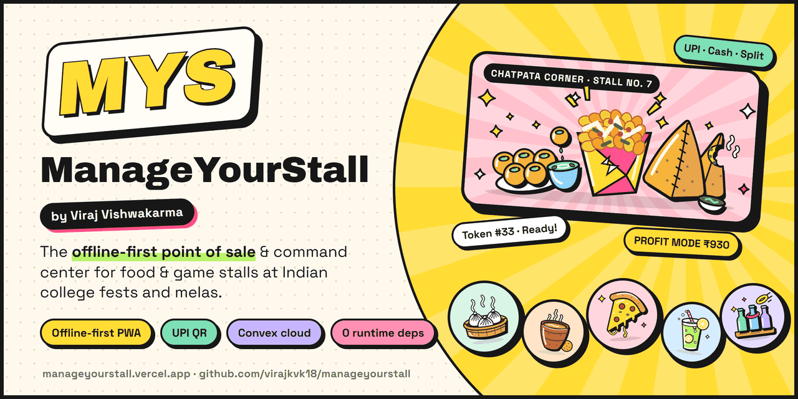
  </a>
</p>

<p align="center">
  <b>An offline-first point of sale for pop-up food &amp; game stalls at Indian college fests and melas.</b>
  Sell through the rush, take cash or a UPI QR, run a kitchen token queue, and split the money between partners exactly to the
  paisa, with or without a network.
</p>

<p align="center">
  <a href="https://manageyourstall.vercel.app"></a>
</p>

<p align="center">
  
  
  
</p>

<p align="center">
  <a href="https://manageyourstall.vercel.app"><b>Live app</b></a> ·
  <a href="#see-it-in-action">Screenshots</a> ·
  <a href="#engineering-highlights">Highlights</a> ·
  <a href="#how-it-works">How it works</a> ·
  <a href="#testing">Testing</a> ·
  <a href="#how-it-was-built">How it was built</a> ·
  <a href="#about-and-contact">Contact</a>
</p>

<p align="center">
  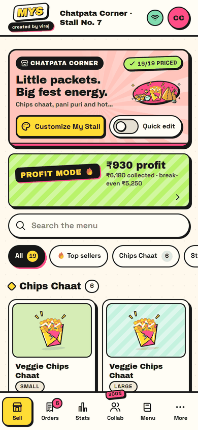<br>
  <sub><b>A full sale on a phone:</b> tap items, pay by UPI QR, get a token, the kitchen marks it ready.</sub>
</p>

> **Try it in about a minute (best on a phone):** open [the app](https://manageyourstall.vercel.app) → **Start my stall** →
> type any name → **Next** → keep the Street Chaat theme → **Next** → **Skip** the event, team and payment steps →
> **Keep it on this phone only** → **Next** → **Open my stall** → tap a few items → **Review & Pay** → **Cash** →
> **Complete sale**. No account needed; the stall lives in your browser.

## What I built

*By **Viraj Vishwakarma**, November 2026. Built contract-first with AI coding agents; [how that worked](#how-it-was-built).*

A stall at a college fest lasts one or two evenings: three friends, one phone, a cash box, a UPI ID, patchy 4G and a queue of
30 hungry people. MYS is the app for that evening.

- **Works with no network.** Each sale is one IndexedDB transaction (requesting `durability: 'strict'`), and the screen shows
  it only after the transaction completes. A service worker caches the app; cloud sync is optional and never blocks the counter.
- **Money that always adds up.** Integer paise end to end, a checkout that commits once even on a double-tap or retry, and a
  partner settlement exact to the paisa (largest-remainder rounding in `BigInt`, fuzzed over 400 seeds).
- **No framework, no build step, zero runtime dependencies.** About 25k lines of vanilla ES modules served as-is, including a
  QR encoder written to the ISO/IEC 18004 spec and checked by decoding every test symbol with a real decoder (jsQR).
- **A small, real backend.** Convex with its own scrypt password auth, hash-only session tokens, login lockout, team logins
  with a stall code, and cloud snapshots guarded by a revision check.
- **Tested like a ledger, because it is one.** 487 Node tests (including a differential fuzz of the v1 → v2 data migration and
  a ~200-order rush checked against an independent money model) plus 213 Playwright tests at 4 screen sizes.

---

## See it in action

The screenshots use **seeded demo data**, not a real stall: **Chatpata Corner** (Stall No. 7, Diwali Mela 2026, Jabalpur), run
by three partners. By 9:18 pm it has taken **32 orders and 11 game plays, ₹6,180 collected** (₹2,490 cash + ₹3,690 UPI)
against **₹5,250 of bills**, so it is in **profit mode: ₹930 net profit, 117% of costs recovered**.

<table>
  <tr>
    <td width="50%">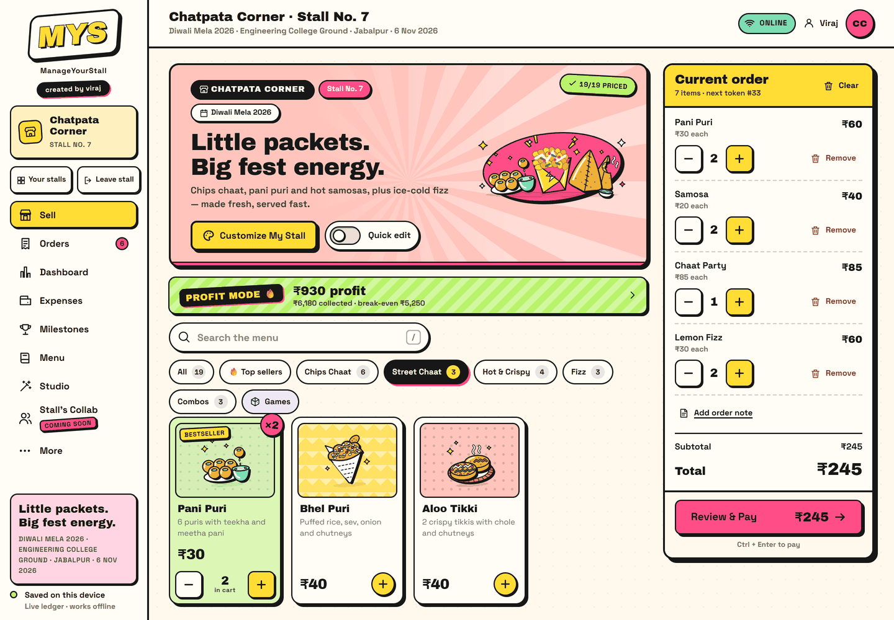<br><sub><b>Sell:</b> themed hero, searchable menu, and a live cart with the next token number.</sub></td>
    <td width="50%">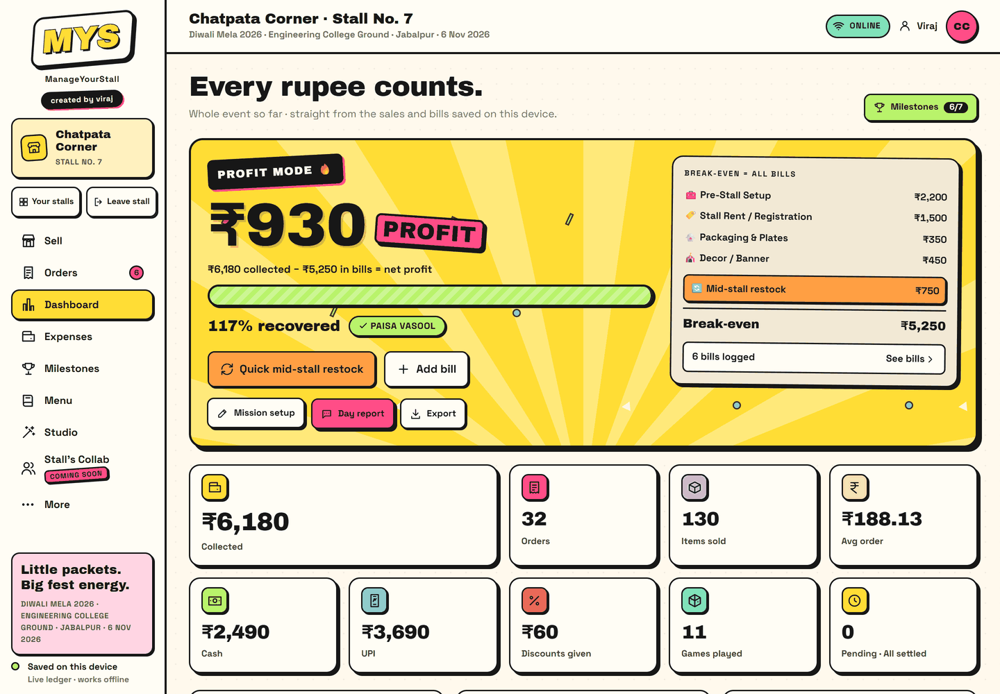<br><sub><b>Dashboard:</b> ₹6,180 collected against ₹5,250 of bills = ₹930 net profit.</sub></td>
  </tr>
  <tr>
    <td width="50%">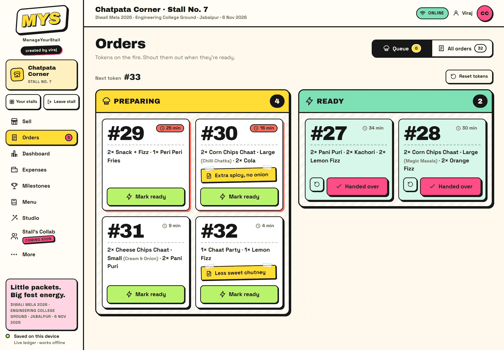<br><sub><b>Orders:</b> the kitchen token queue, Preparing → Ready → Handed over, with order notes.</sub></td>
    <td width="50%">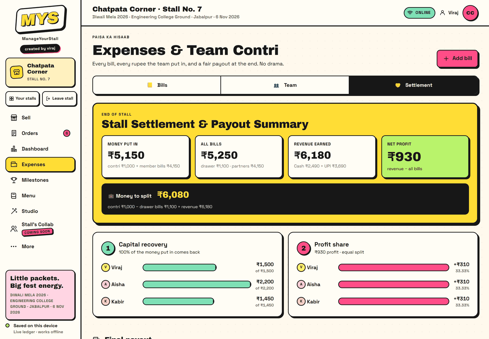<br><sub><b>Settlement:</b> everyone gets their money back first, then the profit is split.</sub></td>
  </tr>
</table>

<p align="center">
  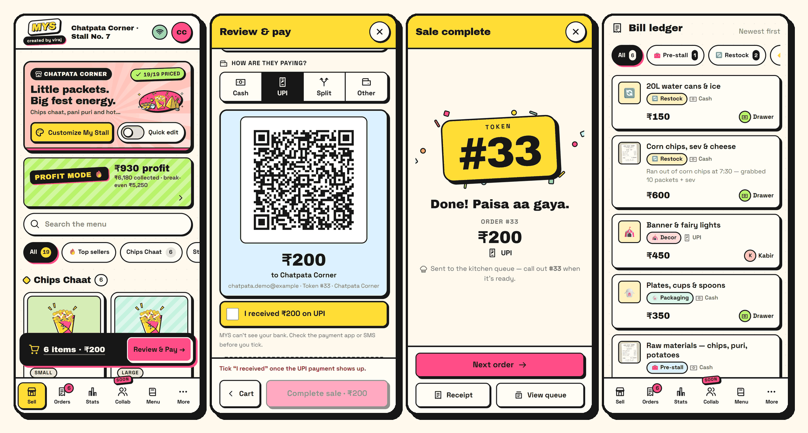<br>
  <sub><b>On a phone:</b> a floating checkout bar · an exact-amount UPI QR (the cashier confirms the money arrived) · a big token to call out · the bill ledger with receipt photos.</sub>
</p>

<details>
<summary><b>More screens</b> (setup flow, 8 more desktop screens, phone and tablet layouts)</summary>
<br>

<p align="center">
  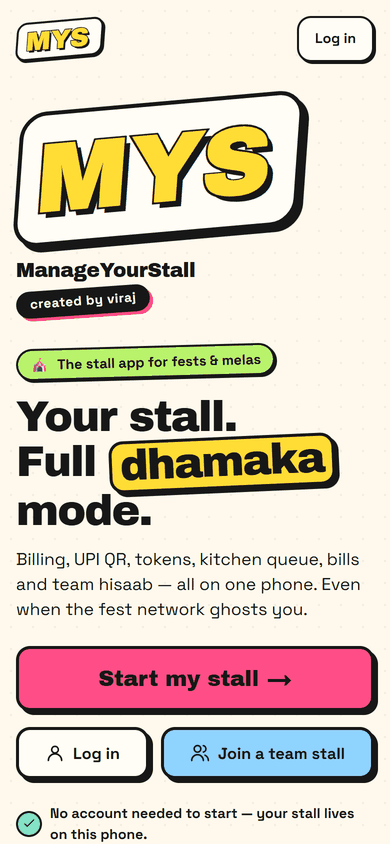<br>
  <sub><b>Setup:</b> from zero to a working stall in seven steps, with no account.</sub>
</p>

<table>
  <tr>
    <td width="50%">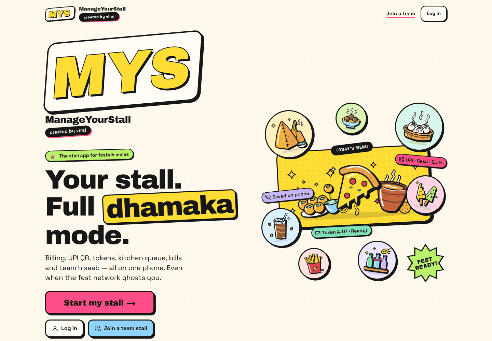<br><sub><b>Landing:</b> start a stall without an account.</sub></td>
    <td width="50%">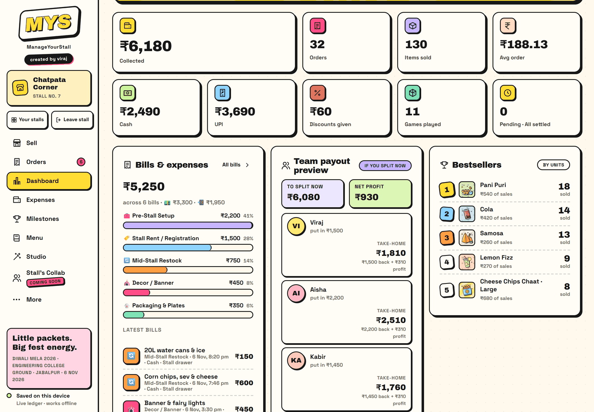<br><sub><b>Dashboard insights:</b> cash vs UPI, bills by category, payout preview, bestsellers.</sub></td>
  </tr>
  <tr>
    <td width="50%">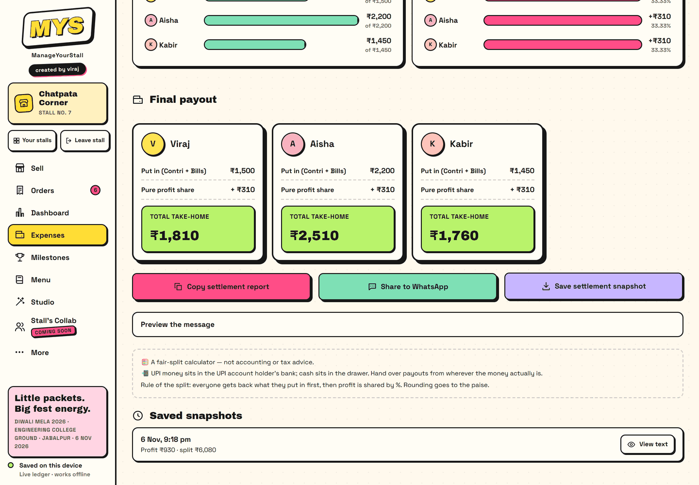<br><sub><b>Final payout:</b> per-partner take-home, ready to share on WhatsApp.</sub></td>
    <td width="50%">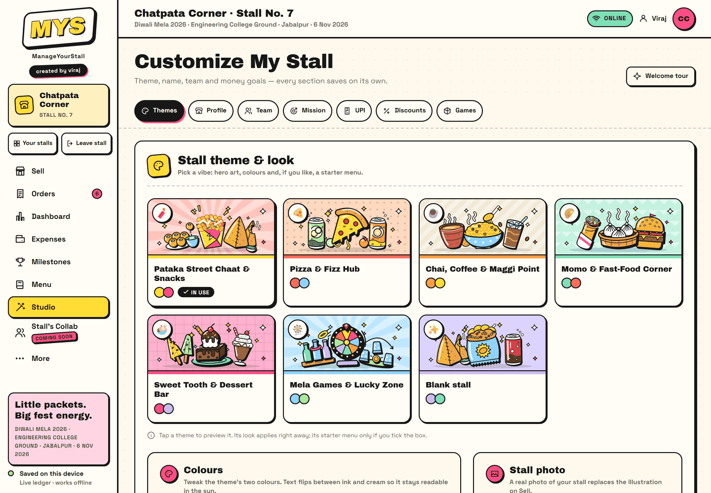<br><sub><b>Studio:</b> six illustrated themes plus Blank, switched in one tap.</sub></td>
  </tr>
  <tr>
    <td width="50%">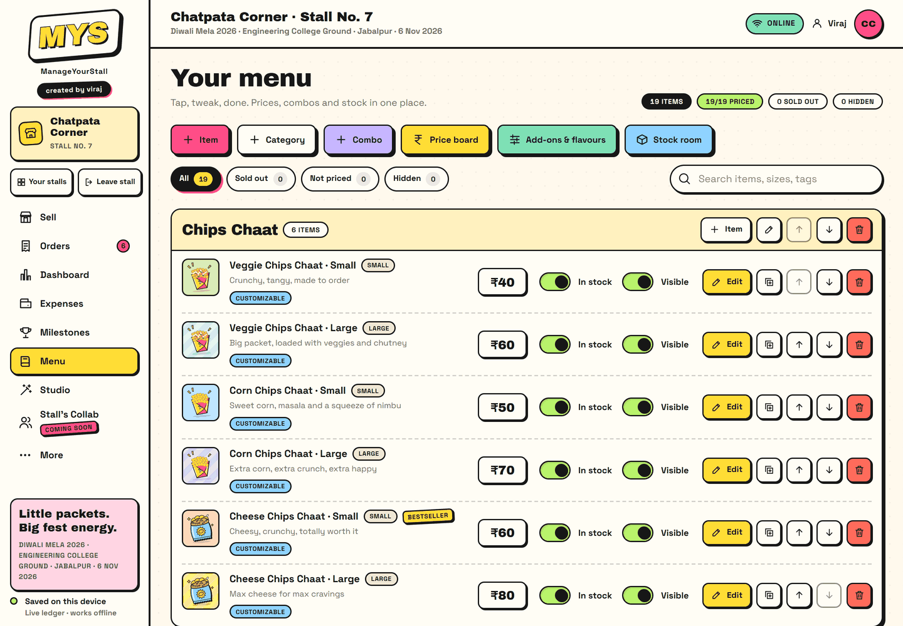<br><sub><b>Menu manager:</b> prices, stock, visibility, combos and add-ons.</sub></td>
    <td width="50%">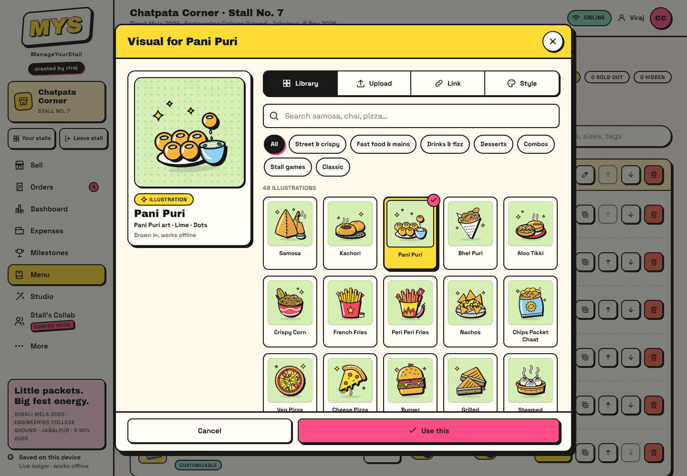<br><sub><b>Visual picker:</b> 48 SVG illustrations that work offline, or your own photo.</sub></td>
  </tr>
  <tr>
    <td width="50%">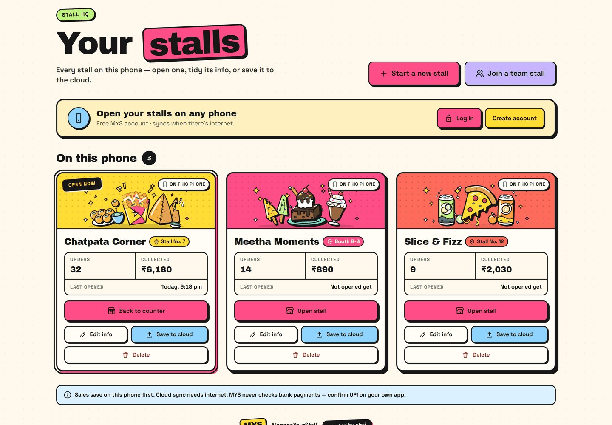<br><sub><b>Your stalls:</b> several stalls on one device; any of them can be saved to the cloud.</sub></td>
    <td width="50%">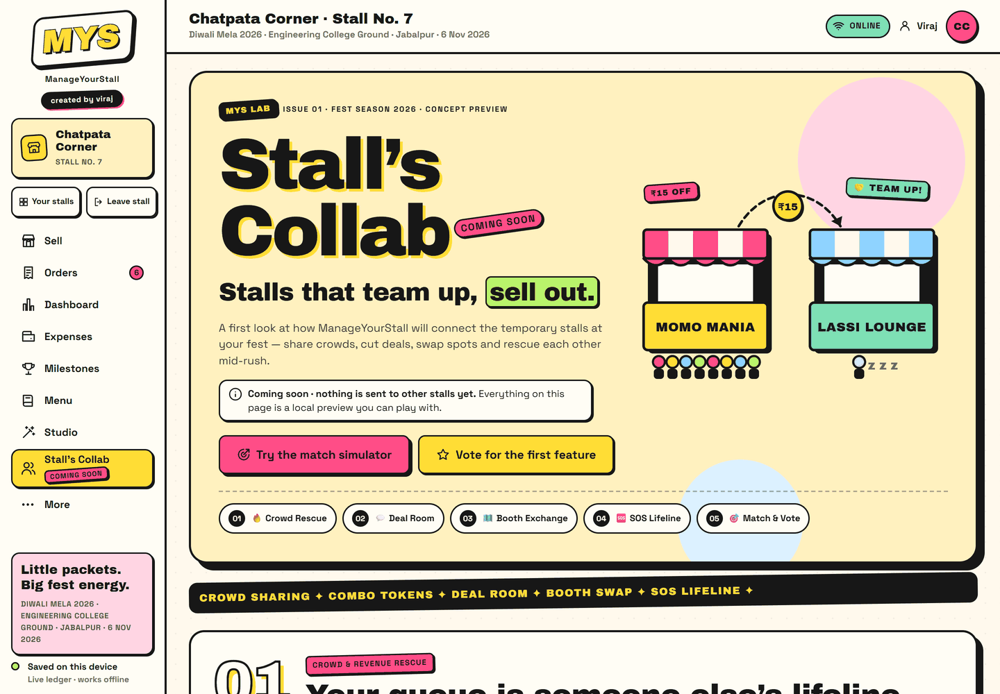<br><sub><b>Stall's Collab:</b> a concept page for stalls that team up (not built yet).</sub></td>
  </tr>
</table>

<p align="center">
  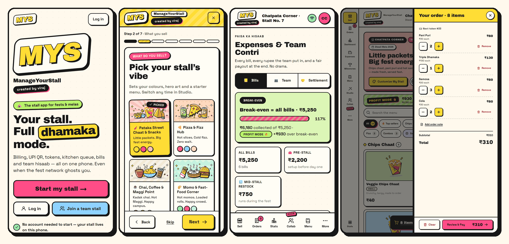<br>
  <sub>Phone: landing · setup step 2 · expenses overview. Tablet: the cart opens as a drawer next to the menu.</sub>
</p>

</details>

---

## Engineering highlights

Six parts that carry the weight, strongest first. Every link to specific lines is pinned to commit
[`d4619e9`](https://github.com/virajkvk18/manageyourstall/commit/d4619e9932c9d4184aeed3338d0d876f8e6a2838), so the line numbers
stay correct.

### 1. Exact money: integer paise and a settlement that is exact to the paisa

Money is never a float: ₹1 = 100 paise. Typed amounts are parsed as strings, not with `parseFloat`
([`paise()`][util-paise] rejects junk, more than 2 decimals and amounts over ₹10,00,000). At the end of the stall,
[`teamSettlement`][domain-settle] pays back each partner's capital (pro-rata if the stall made a loss) and then splits the
profit. Both steps use largest-remainder allocation. The multiply runs in `BigInt` because a large pot times a capital weight,
both in paise, can pass `Number.MAX_SAFE_INTEGER` (2^53 − 1):

```js
  for (const w of weights) {
    const n = T * BigInt(w);
    parts.push(Number(n / W));
    rems.push(n % W);
  }
  let left = total - parts.reduce((a, b) => a + b, 0);
  const order = weights.map((_, i) => i).sort((a, b) => (rems[b] > rems[a] ? 1 : rems[b] < rems[a] ? -1 : a - b));
  for (let k = 0; left > 0; k++, left--) parts[order[k]]++;
  return parts;
}
```
<sub>📄 [`dist/domain.mjs#L1549-L1558`][domain-allocate] (`allocate`; `T` and `W` are the `BigInt` total and weight sum) · a fuzz over seeds 1…400 (1–7 partners, voids, refunds, removed partners, huge amounts) asserts `Σ payout = max(pot, 0)`: [`tests/money.test.mjs#L255`][money-fuzz]</sub>

For example, ₹1,000.00 of profit split three ways is 100,000 paise: `allocate` gives 33,334 / 33,333 / 33,333. The leftover
paisa goes to the largest remainder (ties go to the earlier partner), so the parts always sum to the total.

### 2. Atomic writes and a checkout that can't charge twice

Every state change (a sale, a refund, a bill) runs a pure function *inside* one IndexedDB `readwrite` transaction. If it throws,
the transaction aborts and nothing is written, so a half-saved sale can't exist. Async functions are refused, because an `await`
would let IndexedDB commit the transaction early. The same block refuses a write if another tab switched the phone to a
different stall, upgrades old data on read, and bumps the revision the sync engine relies on:

```js
  const res = await transact([STATE], 'readwrite', async tx => {
    const os = tx.objectStore(STATE);
    const meta = await loadMeta(os);
    const entry = meta.activeStallId ? entryOf(meta, meta.activeStallId) : null;
    if (!entry) throw Error(NO_STALL);
    if (stallId && stallId !== entry.id) throw Error('Another tab switched this phone to a different stall. Reopen your stall and try again.');
    id = entry.id;
    const next = migrate((await done(os.get(entry.key))) || initialState());
    const output = fn(next);
    if (output instanceof Promise) {
      output.catch(() => {});
      throw Error('Storage mutations must be synchronous.');
    }
    next.revision = (Number.isSafeInteger(next.revision) ? next.revision : 0) + 1;
    os.put(next, entry.key);
    touch(entry, next);
    os.put(meta, META_KEY);
    return {state: next, output};
  });
```
<sub>📄 [`dist/storage.mjs#L328-L346`][storage-mutate] (inside `mutate`) · tests: [rollback][storage-rollback], [async refused][storage-async]</sub>

**Idempotent checkout.** The cart's `draftId` becomes the order id, and [`createOrder`][domain-createorder] returns the existing
order if that id is already there. This is race-free because IndexedDB runs `readwrite` transactions on the same store one
after another, so a second identical checkout sees the first one's committed order. A test fires **8 concurrent commits with
the same id** and gets exactly 1 order and 1 payment row ([`tests/storage.test.mjs#L136-L145`][storage-concurrent]).

### 3. Cloud sync that never overwrites silently

The phone is the source of truth; the cloud holds one snapshot per stall. Each push names the `baseRevision` it started from.
[`commitSnapshot`][stalls-commit] is a Convex mutation, and Convex runs mutations as serializable transactions, so the revision
check and the update are atomic. On a mismatch it deletes the file it was just sent and returns a conflict:

```ts
    if (!args.force && args.baseRevision !== stall.revision) {
      await ctx.storage.delete(args.storageId);
      return {
        ok: false as const,
        conflict: true as const,
        revision: stall.revision,
        snapshotAt: stall.snapshotAt ?? null,
        snapshotDevice: stall.snapshotDevice ?? null,
      };
    }
    const previous = stall.snapshotId;
    const revision = stall.revision + 1;
```
<sub>📄 [`convex/stalls.ts#L171-L182`][stalls-check]</sub>

`force` is sent only when the owner explicitly picks **Keep this device's copy**. The other choice, **Use the cloud copy**,
[downloads a backup of this phone's copy first][stalls-ui-conflict]. The cloud keeps only the latest snapshot (the previous file
is deleted on success), which is why both paths are a person's decision, never automatic.

On the client, a commit marks the stall dirty and schedules a push 4 s later (`SYNC_DEBOUNCE_MS = 4000`). Pushes for one stall
are serialized by a small per-key FIFO lock, so two pushes for the same stall never overlap:

```js
function lock(map, key, fn) {
  const prev = map.get(key) || Promise.resolve();
  const run = prev.then(fn, fn);
  const tail = run.then(() => undefined, () => undefined);
  map.set(key, tail);
  tail.then(() => {
    if (map.get(key) === tail) map.delete(key);
  });
  return run;
}
```
<sub>📄 [`dist/cloud.mjs#L515-L524`][cloud-lock] · after an upload the engine re-checks the local revision and queues another push if it moved ([L783–792][cloud-later]) · downloads go through `validateBackup` ([L865–869][cloud-validate]) · a pull refuses to overwrite unsynced local sales ([L856][cloud-pull]) · the browser talks to Convex with plain `fetch`, no SDK ([L183][cloud-fetch])</sub>

### 4. Differential fuzzing of the v1 → v2 data migration

MYS grew out of a single-stall app, **Packet Pataka**. Devices that ran it upgrade in place: same IndexedDB database, legacy
key kept. To prove nothing is lost, the test keeps a copy of the original v1 domain module
([`tests/fixtures/v1-domain.mjs`](tests/fixtures/v1-domain.mjs), byte-identical to `dist/domain.mjs` at commit
[`108f789`](https://github.com/virajkvk18/manageyourstall/blob/108f789/dist/domain.mjs)). A seeded generator drives that v1
code the way the v1 UI did, then v2 [`migrate()`][domain-migrate] runs on the result, and every report number, per-order
balance, payment row, stock count, game play, bill and audit entry is compared:

```js
    // Reports: every v1 money/count field.
    assert.deepEqual(v2Numbers(s2, c), v1Numbers(s1, v1c), where('report numbers'));
    const r2 = report(s2, c);
    assert.equal(r2.mission.collected, V1.report(s1, v1c).collected, where('mission collected'));
    assert.equal(r2.mission.target, v1c.target + sum(s1.expenses, e => e.amount), where('break-even = target + expenses (§14)'));

    // Per-entity balances, ledger rows and stock.
    for (const x of [...s1.orders, ...s1.games]) assert.equal(netFor(s2, x.id), V1.netFor(s1, x.id), where(`net of ${x.id}`));
    assert.deepEqual(s2.payments, s1.payments.filter(p => p.amount !== 0), where('payment ledger (minus ₹0 rows)'));
    assert.deepEqual(stockUsed(s2), V1.stockUsed(s1), where('stockUsed'));
    assert.equal(s2.orders.length, s1.orders.length, where('order count'));
```
<sub>📄 [`tests/migration-fuzz.test.mjs#L674-L684`][fuzz-excerpt] · 60 + 15 seeds on every `npm test`; `MYS_FUZZ_SEEDS=400` runs 400 + 100</sub>

The one deliberate difference: v1 could store ₹0 payment rows (a promo that covered the whole order), and v2 drops them. So
"lossless" here means every rupee, order and setting survives, not every row.

### 5. A QR encoder checked by an independent decoder

The UPI QR comes from a 551-line pure encoder: byte mode with UTF-8, versions 1–40, error-correction levels L/M/Q/H,
Reed–Solomon over GF(256), and mask choice by the four ISO penalty rules. It is written in-house because of the
zero-runtime-dependency rule, and it is trusted only because of how it is tested: every symbol is rasterised and decoded by
**jsQR**. The tests decode versions 1, 2, 5, 7, 10, 15, 25 and 40, all 4 ECC levels, all 8 masks and Hindi UTF-8 text; a
separate reference penalty scorer in the test checks the automatic mask choice; and encoding a UPI link takes under 30 ms.

```js
function roundTrip(text, opts) {
  const qr = encodeQR(text, opts);
  const result = decode(qr);
  assert.ok(result, `jsQR could not decode v${qr.version}-${qr.ecc} mask ${qr.mask}`);
  assert.deepEqual([...result.binaryData], [...new TextEncoder().encode(text)]);
  assert.equal(result.data, text);
  assert.equal(result.version, qr.version);
  return qr;
}
```
<sub>📄 [`tests/qr.test.mjs#L60-L68`][qr-roundtrip] · encoder: [GF(256) tables][qr-gf], [`rsRemainder`][qr-rs], [`encodeQR`][qr-encode]</sub>

### 6. Custom auth on Convex, with its limits stated

No third-party identity provider: users sign in with a login ID, and team members join one stall with a stall code
(`MYS-XXXXX`) and a team password. Passwords use Node `scrypt` (N = 16384, r = 8, p = 1, 64-byte key, 16-byte random salt,
NFKC-normalised) and are compared with `timingSafeEqual` ([`verifyPassword`][auth-verify]). A login with an unknown ID still
runs scrypt, so login timing doesn't reveal which accounts exist; sign-up necessarily does ("already taken"). Session tokens
are 32 random bytes and [only their SHA-256 is stored][auth-session], so a database leak can't be replayed. After 5 failures in
24 h a login ID or stall code is locked for 1 minute, doubling up to 1 hour ([`lockMs`][auth-lockms]).

The trade-offs are listed under [Known limits](#known-limits-and-next-steps): lockout is best-effort, N = 2^14 is Node's
default rather than the higher current OWASP guidance, and there is no password-reset flow.

<details>
<summary><b>More: the SVG sprite, measured render times, the precache check, CSV safety</b></summary>

- **SVG sprite.** The UI re-renders `#app` with `innerHTML` after every change, so inlining illustrations made Sell heavy. Now
  one hidden `<svg>` of 48 `<symbol>`s is injected once outside `#app` ([`artSprite`][lib-sprite],
  [`installArtSprite`][core-sprite]) and each card emits a `<use>`. All 48 illustrations take 173,593 characters inline vs
  10,349 as references. Sell's `#app` is now about 47 KB.
- **Measured render times** (headless Chrome on a laptop; numbers vary by machine): median full `render()` of Sell ≈ 12–14 ms,
  tap → commit → re-render ≈ 20 ms; with the CPU throttled 4×, ≈ 65–80 ms and ≈ 95–140 ms. A Playwright guard
  ([`perf.spec.mjs`][perf-spec]) fails at 150 KB / 250 ms / 1.5 s; those are loose regression limits for slow shared
  machines, not targets.
- **Precache check.** [`scripts/check.mjs`][check-precache] fails if the service worker's `ASSETS` list and the files in `dist/`
  differ in either direction. A new worker waits for `SKIP_WAITING` ([`sw.js`][sw-skip]), so the cashier sees an "Update"
  button instead of a reload mid-order, and `sw.js` is served `no-cache, no-store` ([`vercel.json`](vercel.json)). The check
  compares the file list, not contents; see the cache-name limit below.
- **CSV formula-injection protection.** Cells starting with `=` `+` `-` `@`, a tab or a CR get a leading apostrophe, real
  negative numbers stay numeric, and the file starts with a UTF-8 BOM so Excel reads ₹ correctly ([`csv()`][domain-csv]).

</details>

---

## How it works

MYS is a static PWA. [`dist/`](dist) **is** the app: Vercel serves it as-is with no build step, so what the tests load is
exactly what ships. In the browser there are three layers:

1. **A pure domain layer** (`domain`, `catalog`, `templates`, `qr`, `library`): no DOM, no storage, deterministic. JSDoc types
   are checked by `tsc --checkJs` (non-strict). It holds the ledger, payments, tokens, reports, settlement, migration and backup
   validation.
2. **A storage kernel** ([`storage.mjs`](dist/storage.mjs)) that runs every write as a pure function inside one IndexedDB
   transaction (highlight 2).
3. **20 UI modules** (a kernel, a shell and 18 screens) that re-render `#app` after each commit. Every interpolated value goes
   through one HTML-escaping helper ([`esc`][util-esc]).

The cloud is secondary: [`cloud.mjs`](dist/cloud.mjs) watches commits and pushes whole-stall snapshots to Convex in the
background (highlight 3). The backend is 4 tables (`users`, `sessions`, `loginAttempts`, `stalls`) plus file storage for
snapshots, 15 public functions and 2 cleanup crons (orphan uploads every hour; expired sessions and stale lockout rows every
6 hours). Local runs and tests use the Convex **dev** deployment; the live site uses **prod** ([`dist/config.mjs`](dist/config.mjs)).

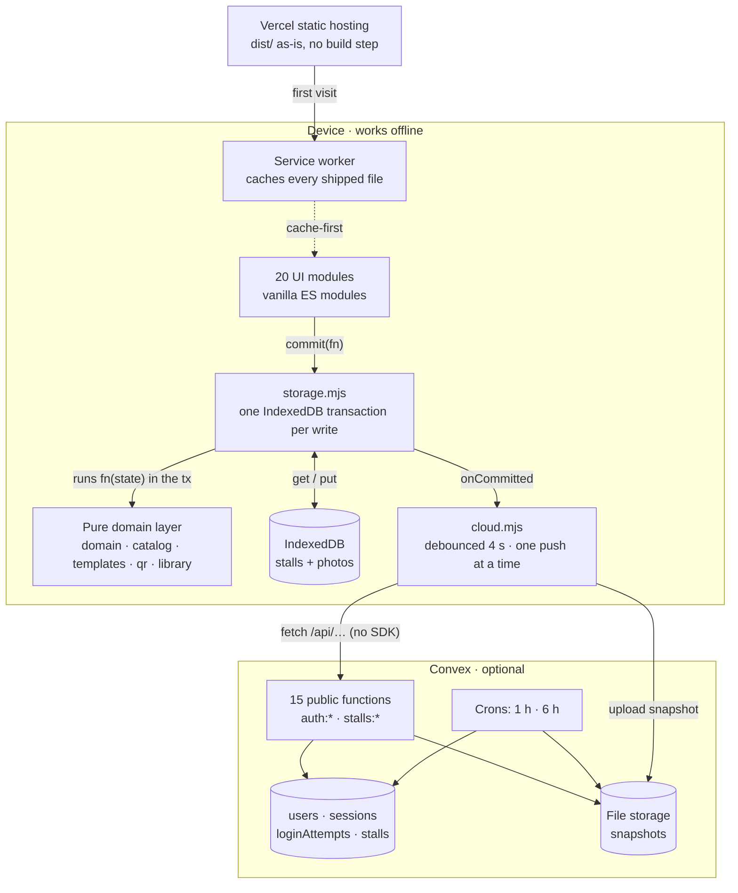

The design was written down before the code. [`ARCHITECTURE.md`](ARCHITECTURE.md) (§0–§17) is the contract: the data model and
its invariants, every pure-module signature, storage semantics, the UI kernel API, Convex function signatures and the sync
protocol. Its opening rule: "If code and this document disagree, fix the code — or, if the document is wrong, change the
document in the same change and say why."

<details>
<summary><b>Sequence: an offline sale, then background sync</b></summary>
<br>

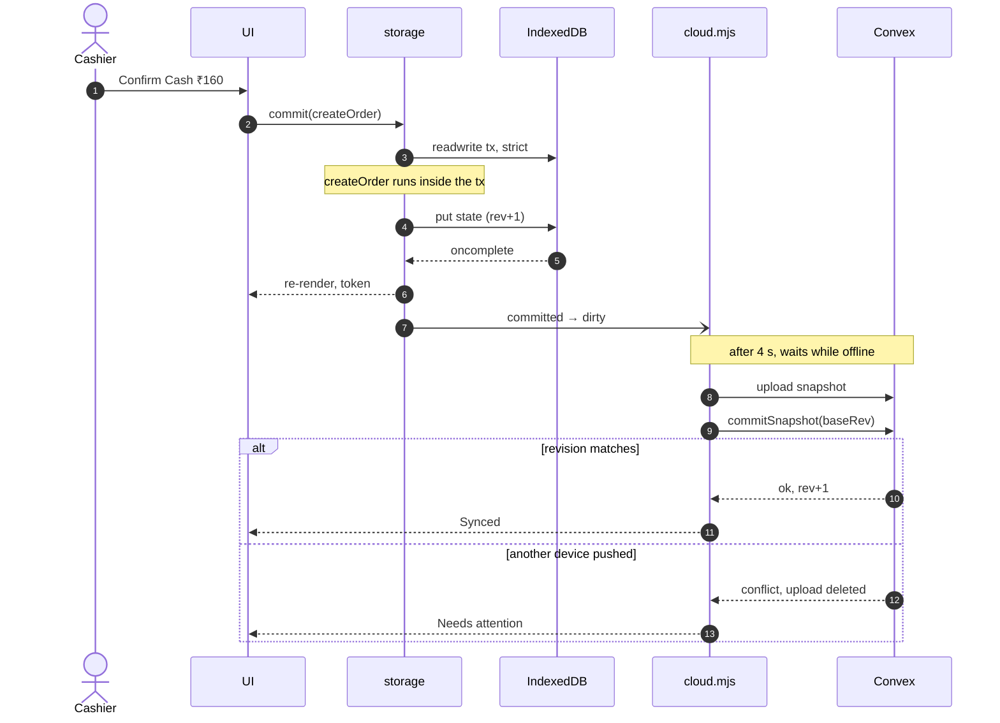

</details>

<details>
<summary><b>Flow: end-of-stall settlement, with the demo stall's numbers</b></summary>
<br>

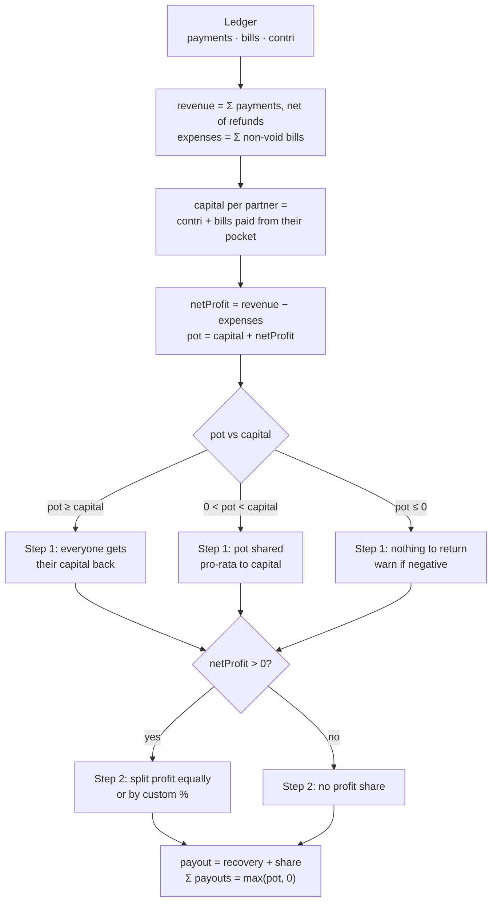

**Worked example (the demo stall).** The partners put in ₹1,000 of contri and paid ₹4,150 of bills from their own pockets, so
capital = ₹5,150. The cash drawer paid the other ₹1,100 of bills. Pot = ₹1,000 + ₹6,180 − ₹1,100 = **₹6,080** = capital ₹5,150
+ profit ₹930. Step 1 returns each partner's capital (Viraj ₹1,500, Aisha ₹2,200, Kabir ₹1,450); step 2 splits the ₹930
equally (₹310 each). Payouts: **₹1,810 + ₹2,510 + ₹1,760 = ₹6,080**. (₹930 divides evenly; see highlight 1 for a split
where the rounding matters.)

</details>

<details>
<summary><b>Data model: the device ledger and the Convex tables</b></summary>
<br>

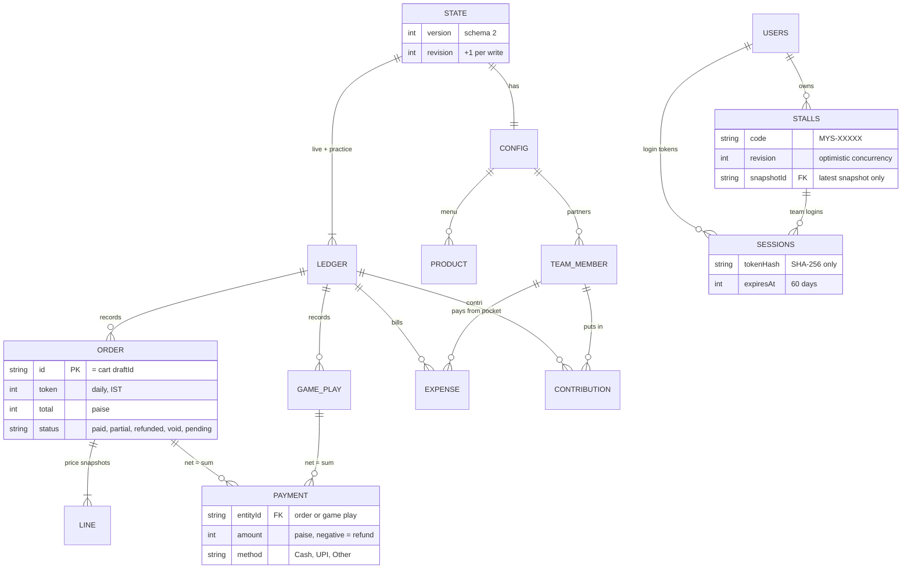

Money lives in a **payment ledger**: an order's balance is the sum of its payment rows, and a refund is a negative row. Order
lines are price snapshots, so editing the menu never rewrites past orders.

</details>

---

## Testing

```sh
npm run verify          # static checks + type check + 487 unit tests (under a minute)
npm run test:browser    # 213 Playwright tests × 4 viewports
```

| Layer | What it proves | Tests |
|---|---|---|
| Pure domain | `domain` 69 · `catalog` 211 · `templates` 33 · `money` 30 · `art` 20 · `qr` 12 | 375 |
| Storage | The real `storage.mjs` on `fake-indexeddb`: rollback, idempotency, multiple stalls, in-place v1 upgrade | 24 |
| Sync client | `cloud.mjs` against an in-memory fake of the Convex HTTP API | 27 |
| Migration | A recorded v1 fixture (10) + differential fuzz through the original v1 code (11) | 21 |
| Integration | Cross-module checks, a seeded ~200-order rush, corrupted backups | 35 |
| Live backend | The real Convex **dev** deployment over HTTP (skips when unreachable) | 5 |
| **Unit total** | `node --test tests/*.test.mjs` → **487 pass, 0 fail** | **487** |
| Browser | 19 Playwright spec files at desktop 1440×1000, tablet 820×1180, phone 390×844 and 320×740 (touch) | 213 × 4 |

Notes, so the numbers mean what they say:

- `catalog`'s 211 tests include about 165 table-driven rejection cases for `validateConfig` (one test per malformed config).
- 213 × 4 = 852 browser combinations, but about 30 are viewport-specific (phone-only or desktop-only) and skip by design, and
  the live-backend journeys skip when the dev deployment is unreachable.
- The browser suite has about 100 explicit no-horizontal-overflow assertions across the 4 widths.
- Browser tests block the service worker so every run is deterministic. Offline caching is covered by the precache check, not
  by an end-to-end offline reload.
- There is no CI yet; the counts above come from local runs of the commands shown.

**How money correctness is checked:**

| Check | What it does | Where |
|---|---|---|
| Seeded rush | About 200 orders across IST midnight (Cash / UPI / Split / Other, pending, partial refunds, voids, games, bills, stock-outs, combos, retries), checked against an **independent money model after every step** | [`integration.test.mjs#L958`][int-rush] |
| Backup restore | The final rush state round-trips through a backup, and **20 internally inconsistent edits** (inflated or duplicated payments, edited totals and line prices, impossible statuses) are rejected | [`integration.test.mjs#L1035`][int-tamper] |
| Settlement fuzz | Seeds 1…400, 1–7 partners: `Σ payout = max(pot, 0)`, payouts ≥ 0, recovery ≤ capital | [`money.test.mjs#L255`][money-fuzz] |
| Worked settlements | Equal split, a loss, a custom 70/30 with an odd paisa, shares that don't add to 100%, removed partners, a negative pot | [`money.test.mjs#L91`][money-worked] |
| Migration fuzz | Seeded v1 histories replayed through the original v1 code, then compared after `migrate()` | [`migration-fuzz.test.mjs#L805`][fuzz-test] |
| Concurrency | 8 concurrent same-id checkouts → 1 order, 1 payment | [`storage.test.mjs#L136`][storage-concurrent] |

`npm run verify` also runs `scripts/check.mjs` (syntax, imports and precache completeness over all 60 shipped files) and
`tsc --checkJs` over the 12 pure files. Deep migration fuzz: `MYS_FUZZ_SEEDS=400 node --test tests/migration-fuzz.test.mjs`
(400 + 100 seeds, about half a minute).

---

## Decisions and trade-offs

- **No framework, no build step, zero runtime dependencies.** *Why:* `dist/` is the app, so what is tested is exactly what
  ships, there is no supply chain to break, and every file is readable source. *Cost:* no bundling or minification. The first
  visit downloads ≈ 430 KB of JS + CSS gzipped (≈ 610 KB including fonts and icons) as separate ES modules, and full `innerHTML`
  re-renders needed the SVG sprite to stay fast.
- **IndexedDB, not localStorage.** *Why:* real transactions, structured data and room for bill photos; localStorage is
  synchronous, string-only and has no transactions. *Cost:* an async, verbose API (hence the `transact` wrapper), and data that
  lives per browser per device, hence backups and cloud snapshots.
- **One record per stall, one snapshot per push.** *Why:* the ledger's invariants hold inside one transaction, and the cloud
  copy is simply a validated backup. *Cost:* each commit rewrites the whole stall (about 1 KB per order, so ~1 MB at 1,000
  orders), and each sync re-uploads the full JSON including photos. Fine for one or two evenings; a year-round shop would need
  deltas and separately stored photos.
- **Whole-stall snapshots with revision checks, and one checkout device per stall.** *Why:* merging two phones' sales record by
  record is a CRDT-sized problem, and a stall has one counter and one cash box anyway. *Cost:* two phones can't sell into the
  same stall at once; a conflict needs a person's choice.
- **Custom auth on Convex.** *Why:* login IDs (email, phone or username) with no OAuth setup, and team logins scoped to one
  stall, which most providers don't model. *Cost:* security-sensitive code is owned in-house, so it sticks to standard
  primitives; there is no password reset.
- **A pure domain layer with JSDoc types.** *Why:* 487 fast Node tests with no browser, and the same functions run inside the
  storage transaction, the backup validator and the cloud pull. *Cost:* types come from JSDoc checked non-strictly
  (`strict: false`), not TypeScript source.

## Known limits and next steps

- **Service-worker updates.** The cache name is a constant (`mys-shell-v1`), and a browser only installs a new worker when
  `sw.js` itself changes. A release that changes app files but not `sw.js` may not reach devices that visited before. Next:
  derive the cache name from a hash of the precached files in `scripts/check.mjs`.
- **No end-to-end offline test** (see Testing), and **no CI** yet.
- **Cloud.** Sync moves whole-stall snapshots; there is no history in the cloud, so **Keep this device's copy** permanently
  replaces the other device's cloud copy (that device keeps its local data).
- **Storage eviction.** Browsers may clear site data that isn't marked persistent. MYS asks for `navigator.storage.persist()`
  on the More screen, but Safari can delete a site's data after 7 days without a visit unless it is added to the Home Screen.
  Install the app, or keep a backup or cloud save.
- **Auth.** Lockout is per login ID and best-effort under parallel attempts (it slows guessing; it isn't rate limiting), and
  anyone who knows a login ID can trigger it. scrypt uses N = 2^14. Session tokens are 60-day bearer tokens in localStorage,
  and there is no Content-Security-Policy header yet. No password reset.
- **Payments.** UPI and "Other" payments are confirmed by the cashier ticking "I received"; MYS does not talk to banks.
- **Backups** are checked for structure and ledger consistency, not signed: they catch damage and mistakes, not a determined
  forger. The admin PIN guards a shared phone; it isn't account security.
- **Not built yet:** Stall's Collab (cross-stall offers; only a concept page exists), a second live counter per stall, account
  recovery, and an optional bundled build with module preloading for a faster first visit.

---

## How it was built

ManageYourStall is built contract-first with AI coding agents. [`ARCHITECTURE.md`](ARCHITECTURE.md) fixes the data model, the
ledger invariants, every pure-module signature, storage semantics and the sync protocol, and its §1 table gives each file an
owner (the lead, or an agent such as the "domain agent" or the "QR agent"). The code was written by AI coding agents (Claude,
through Claude Code) working against that contract; the commit history shows this openly.

What makes agent-written code trustworthy here is the verification, so that is where the effort went: an independent money
model checked after every step of a ~200-order rush, a differential fuzz against the original v1 code, a real QR decoder as the
oracle for the encoder, and a browser suite at 4 screen sizes. Every number in this README can be reproduced with the commands
under [Testing](#testing).

## Features

<details>
<summary><b>Full feature list</b></summary>

- **Selling.** Big tappable cards with steppers, search, category chips, Top sellers, order notes and
  <kbd>Ctrl</kbd>/<kbd>⌘</kbd> + <kbd>Enter</kbd> to pay ([`sell.mjs`][sell-shortcut]). Sizes, combos with component stock,
  add-ons and flavours, 1-tap sold out, optional stock tracking. Unpriced items stay locked. A practice counter with its own
  ledger for training a new cashier.
- **Payments.** Cash with quick notes (₹50, ₹100, ₹200, ₹500 and Exact; [`CASH_QUICK`][cash-quick]) and instant change; an
  exact-amount UPI QR (`upi://pay?pa=…&am=…&cu=INR`); split cash + UPI; pay-later orders; discount chips; partial or full
  refunds, voids with reasons, and an audit trail. MYS never claims to verify bank payments: the cashier ticks "I received".
- **Kitchen.** A daily token per order (reset at IST midnight or on demand) and a Preparing → Ready → Handed over board.
- **Money and team.** A bill ledger with photos (compressed in the browser to ≤ 1400 px / ≤ 600 KB JPEG;
  [`money.mjs`][money-photo]), 6 categories and who paid; a live break-even bar that flips to PROFIT MODE; team contributions
  ("contri"); the 2-step settlement with a WhatsApp-ready report and saved snapshots; a dashboard with an hourly IST chart.
- **Customization.** 6 illustrated themes plus Blank, Stall Studio (name, event, colours, UPI ID, discounts, partners, games),
  48 SVG illustrations written as code, or your own photos.
- **Accounts and cloud (optional).** A 7-step setup wizard ([`setup.mjs`][setup-steps]), several stalls per device, an MYS
  account to save a stall and open it on another phone, team access with a stall code, and a sync status pill.
- **Data safety.** Atomic transactions, idempotent checkout, multi-tab safety through `BroadcastChannel` (a tab whose stall was
  switched elsewhere can't write into the wrong stall; [`storage.mjs`][storage-tabs]), CSV exports, a full JSON backup with
  photos and a validated restore, separate reset levels with typed confirmation, and a local admin PIN.
- **Responsive and accessible.** Laptop (sidebar and sticky cart), tablet (icon rail and cart drawer) and phone (bottom nav and
  floating checkout bar) layouts; tap targets ≥ 44 px; `prefers-reduced-motion` handled; ARIA labels and focus styles.

</details>

## Run it locally

Requires Node.js 22+. `npm install` only fetches dev tools (Playwright, TypeScript, the Convex CLI, `fake-indexeddb`, `jsqr`).

```sh
git clone https://github.com/virajkvk18/manageyourstall.git
cd manageyourstall
npm install
npm start               # http://127.0.0.1:4173
```

| Script | What it runs |
|---|---|
| `npm start` | `node server.mjs`, a small static server for `dist/` on port 4173 |
| `npm run check` | `scripts/check.mjs`: syntax, imports, precache completeness |
| `npm run typecheck` | `tsc -p tsconfig.json` (`checkJs` over the 12 pure files) |
| `npm test` | `node --test tests/*.test.mjs` |
| `npm run verify` | check + typecheck + unit tests |
| `npm run test:browser` | Playwright at 4 viewports (uses installed Chrome; reuses a server already on 4173) |

**Deploy.** Import the repo in Vercel with no build command and `dist` as the output directory ([`vercel.json`](vercel.json)
already sets this). For the backend, `npx convex dev --once` pushes to a dev deployment and `npx convex deploy` to production;
[`dist/config.mjs`](dist/config.mjs) picks the deployment by hostname. Convex URLs are public by design; the client holds no
secrets.

---

## About and contact

I'm **Viraj Vishwakarma** ([@virajkvk18](https://github.com/virajkvk18)). I made MYS for one specific, chaotic moment: a crowded
fest stall at 9 pm with a queue, a cash box and a weak signal.

**Open to opportunities.** The quickest way to reach me is through my GitHub profile,
[github.com/virajkvk18](https://github.com/virajkvk18).

<p align="center"><sub>Fonts: Space Grotesk and Archivo Black (SIL Open Font License, see <a href="licenses">licenses/</a>).</sub></p>

[util-paise]: https://github.com/virajkvk18/manageyourstall/blob/d4619e9932c9d4184aeed3338d0d876f8e6a2838/dist/util.mjs#L26-L33
[util-esc]: https://github.com/virajkvk18/manageyourstall/blob/d4619e9932c9d4184aeed3338d0d876f8e6a2838/dist/util.mjs#L46-L48
[domain-settle]: https://github.com/virajkvk18/manageyourstall/blob/d4619e9932c9d4184aeed3338d0d876f8e6a2838/dist/domain.mjs#L1577
[domain-allocate]: https://github.com/virajkvk18/manageyourstall/blob/d4619e9932c9d4184aeed3338d0d876f8e6a2838/dist/domain.mjs#L1549-L1558
[domain-createorder]: https://github.com/virajkvk18/manageyourstall/blob/d4619e9932c9d4184aeed3338d0d876f8e6a2838/dist/domain.mjs#L981-L986
[domain-migrate]: https://github.com/virajkvk18/manageyourstall/blob/d4619e9932c9d4184aeed3338d0d876f8e6a2838/dist/domain.mjs#L2564-L2571
[domain-csv]: https://github.com/virajkvk18/manageyourstall/blob/d4619e9932c9d4184aeed3338d0d876f8e6a2838/dist/domain.mjs#L2204-L2211
[money-fuzz]: https://github.com/virajkvk18/manageyourstall/blob/d4619e9932c9d4184aeed3338d0d876f8e6a2838/tests/money.test.mjs#L255
[money-worked]: https://github.com/virajkvk18/manageyourstall/blob/d4619e9932c9d4184aeed3338d0d876f8e6a2838/tests/money.test.mjs#L91
[storage-mutate]: https://github.com/virajkvk18/manageyourstall/blob/d4619e9932c9d4184aeed3338d0d876f8e6a2838/dist/storage.mjs#L328-L346
[storage-tabs]: https://github.com/virajkvk18/manageyourstall/blob/d4619e9932c9d4184aeed3338d0d876f8e6a2838/dist/storage.mjs#L333
[storage-rollback]: https://github.com/virajkvk18/manageyourstall/blob/d4619e9932c9d4184aeed3338d0d876f8e6a2838/tests/storage.test.mjs#L108
[storage-async]: https://github.com/virajkvk18/manageyourstall/blob/d4619e9932c9d4184aeed3338d0d876f8e6a2838/tests/storage.test.mjs#L125
[storage-concurrent]: https://github.com/virajkvk18/manageyourstall/blob/d4619e9932c9d4184aeed3338d0d876f8e6a2838/tests/storage.test.mjs#L136-L145
[stalls-commit]: https://github.com/virajkvk18/manageyourstall/blob/d4619e9932c9d4184aeed3338d0d876f8e6a2838/convex/stalls.ts#L143-L197
[stalls-check]: https://github.com/virajkvk18/manageyourstall/blob/d4619e9932c9d4184aeed3338d0d876f8e6a2838/convex/stalls.ts#L171-L182
[stalls-ui-conflict]: https://github.com/virajkvk18/manageyourstall/blob/d4619e9932c9d4184aeed3338d0d876f8e6a2838/dist/ui/stalls.mjs#L715-L727
[cloud-lock]: https://github.com/virajkvk18/manageyourstall/blob/d4619e9932c9d4184aeed3338d0d876f8e6a2838/dist/cloud.mjs#L515-L524
[cloud-later]: https://github.com/virajkvk18/manageyourstall/blob/d4619e9932c9d4184aeed3338d0d876f8e6a2838/dist/cloud.mjs#L783-L792
[cloud-validate]: https://github.com/virajkvk18/manageyourstall/blob/d4619e9932c9d4184aeed3338d0d876f8e6a2838/dist/cloud.mjs#L865-L869
[cloud-pull]: https://github.com/virajkvk18/manageyourstall/blob/d4619e9932c9d4184aeed3338d0d876f8e6a2838/dist/cloud.mjs#L856
[cloud-fetch]: https://github.com/virajkvk18/manageyourstall/blob/d4619e9932c9d4184aeed3338d0d876f8e6a2838/dist/cloud.mjs#L183
[fuzz-excerpt]: https://github.com/virajkvk18/manageyourstall/blob/d4619e9932c9d4184aeed3338d0d876f8e6a2838/tests/migration-fuzz.test.mjs#L674-L684
[fuzz-test]: https://github.com/virajkvk18/manageyourstall/blob/d4619e9932c9d4184aeed3338d0d876f8e6a2838/tests/migration-fuzz.test.mjs#L805
[qr-roundtrip]: https://github.com/virajkvk18/manageyourstall/blob/d4619e9932c9d4184aeed3338d0d876f8e6a2838/tests/qr.test.mjs#L60-L68
[qr-gf]: https://github.com/virajkvk18/manageyourstall/blob/d4619e9932c9d4184aeed3338d0d876f8e6a2838/dist/qr.mjs#L54-L65
[qr-rs]: https://github.com/virajkvk18/manageyourstall/blob/d4619e9932c9d4184aeed3338d0d876f8e6a2838/dist/qr.mjs#L102-L114
[qr-encode]: https://github.com/virajkvk18/manageyourstall/blob/d4619e9932c9d4184aeed3338d0d876f8e6a2838/dist/qr.mjs#L460
[auth-verify]: https://github.com/virajkvk18/manageyourstall/blob/d4619e9932c9d4184aeed3338d0d876f8e6a2838/convex/authNode.ts#L41-L48
[auth-session]: https://github.com/virajkvk18/manageyourstall/blob/d4619e9932c9d4184aeed3338d0d876f8e6a2838/convex/lib/session.ts#L17-L26
[auth-lockms]: https://github.com/virajkvk18/manageyourstall/blob/d4619e9932c9d4184aeed3338d0d876f8e6a2838/convex/lib/validate.ts#L143-L147
[lib-sprite]: https://github.com/virajkvk18/manageyourstall/blob/d4619e9932c9d4184aeed3338d0d876f8e6a2838/dist/library.mjs#L85-L89
[core-sprite]: https://github.com/virajkvk18/manageyourstall/blob/d4619e9932c9d4184aeed3338d0d876f8e6a2838/dist/ui/core.mjs#L434-L443
[perf-spec]: https://github.com/virajkvk18/manageyourstall/blob/d4619e9932c9d4184aeed3338d0d876f8e6a2838/tests/browser/perf.spec.mjs#L69-L114
[check-precache]: https://github.com/virajkvk18/manageyourstall/blob/d4619e9932c9d4184aeed3338d0d876f8e6a2838/scripts/check.mjs#L35-L44
[sw-skip]: https://github.com/virajkvk18/manageyourstall/blob/d4619e9932c9d4184aeed3338d0d876f8e6a2838/dist/sw.js#L87-L89
[int-rush]: https://github.com/virajkvk18/manageyourstall/blob/d4619e9932c9d4184aeed3338d0d876f8e6a2838/tests/integration.test.mjs#L958
[int-tamper]: https://github.com/virajkvk18/manageyourstall/blob/d4619e9932c9d4184aeed3338d0d876f8e6a2838/tests/integration.test.mjs#L1035
[sell-shortcut]: https://github.com/virajkvk18/manageyourstall/blob/d4619e9932c9d4184aeed3338d0d876f8e6a2838/dist/ui/sell.mjs#L1010
[cash-quick]: https://github.com/virajkvk18/manageyourstall/blob/d4619e9932c9d4184aeed3338d0d876f8e6a2838/dist/constants.mjs#L114
[money-photo]: https://github.com/virajkvk18/manageyourstall/blob/d4619e9932c9d4184aeed3338d0d876f8e6a2838/dist/ui/money.mjs#L517-L518
[setup-steps]: https://github.com/virajkvk18/manageyourstall/blob/d4619e9932c9d4184aeed3338d0d876f8e6a2838/dist/ui/setup.mjs#L31-L39
